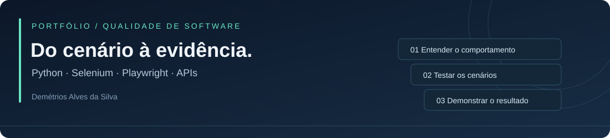

# Demétrios Alves da Silva

**QA Analyst · Testes funcionais e de APIs · Automação com Python**

Pagamentos, adquirência e seguros · São Paulo, Brasil

[LinkedIn](https://www.linkedin.com/in/demetriosalvess) · [Contato](mailto:demetrios.10@hotmail.com) · [Portfólio completo](PORTFOLIO.md) · [Experiência e formação](docs/EXPERIENCIA.md)

## Sobre mim

Atuo com qualidade de software em times ágeis, da análise de requisitos à homologação e validação em produção. Minha experiência reúne testes funcionais, exploratórios, regressivos e ponta a ponta, validação de APIs, BDD e análise de dados.

Na NTT DATA, participo da Squad de Sinistro do cliente MAPFRE em um projeto LATAM. Antes, atuei na Fiserv e na Inmetrics, com sistemas financeiros, pagamentos e integrações.

Os projetos pessoais abaixo mostram minha evolução em programação e automação: organização do código, cenários de teste, execução reproduzível e evidências com limites explícitos.

## Projetos em destaque

### Automação web com Selenium · público

Formulário de cadastro com **Page Objects, esperas explícitas e sessões isoladas**. Oito testes unitários aprovados no relatório disponível; 11 cenários de navegador definidos, com execução real ainda pendente após falha na inicialização do Chrome.

[Repositório](https://github.com/Demetrios10/Automacao-Selenium-Python) · [Estudo de caso](https://github.com/Demetrios10/Automacao-Selenium-Python/blob/main/docs/PORTFOLIO.md) · [Evidências](https://github.com/Demetrios10/Automacao-Selenium-Python/blob/main/docs/RELATORIO-TESTES.md)

### Fundamentos de Python · público

**33 aulas em seis temas**, com tratamento de entradas, execução independente e testes com unittest. O relatório disponível registra nove testes aprovados, incluindo verificações que percorrem todas as aulas.

[Repositório](https://github.com/Demetrios10/Fundamentos-Python) · [Estudo de caso](https://github.com/Demetrios10/Fundamentos-Python/blob/main/docs/PORTFOLIO.md) · [Trilha de estudo](https://github.com/Demetrios10/Fundamentos-Python/blob/main/curso_python/README.md)

### API Monitor e automação com Playwright · privados

Aplicação de monitoramento com Python/FastAPI e painel responsivo, acompanhada de uma suíte separada com **43 testes aprovados no Chromium**. Os casos cobrem acesso, recuperação de senha, monitores, incidentes e quatro larguras de tela, com banco descartável por teste e integrações externas controladas.

O código e os relatórios completos têm acesso restrito. Veja o [resumo técnico público](PORTFOLIO.md#api-monitor-e-playwright) para conhecer o escopo e os limites da validação.

## Competências aplicadas

| Contexto | Prática |
|---|---|
| Experiência profissional | Testes funcionais, exploratórios, regressivos, APIs, BDD, homologação e análise de defeitos |
| Automação nos projetos | Python, Selenium WebDriver, Playwright, pytest, unittest e Page Objects |
| Aplicação pessoal | FastAPI, SQLite, Jinja2, JavaScript e CSS responsivo |
| Evidências e colaboração | Git, relatórios HTML/JUnit, mocks, ambientes descartáveis e documentação |
| Ferramentas profissionais | Postman, Jira, Confluence, Zephyr, QTest e Oracle |

## Evolução atual

- Entregue: trilha Python, automação Selenium, API Monitor e suíte Playwright executada localmente.
- Próximo passo: configurar o acesso privado e executar o workflow manual do Playwright no GitHub Actions.
- Pendente: validar os 11 cenários Selenium em um ambiente com Chrome funcional e ampliar os testes de integrações reais.

O [portfólio completo](PORTFOLIO.md) reúne problema, solução, decisões e evidências de cada projeto. A [trajetória profissional](docs/EXPERIENCIA.md) detalha experiência, formação e cursos.

**Vamos conversar sobre qualidade de software e automação?** [Conecte-se comigo no LinkedIn](https://www.linkedin.com/in/demetriosalvess).

Revisado em 09/11/2026. Resultados são registros das execuções documentadas, não indicadores contínuos de CI.
