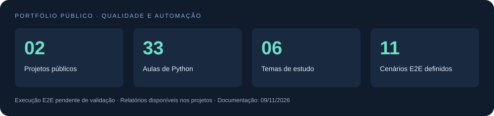

# Demétrios Alves da Silva

**QA Analyst | AI Applied to Software Testing**

Meios de Pagamento · Adquirência · Serviços Financeiros · Seguros

São Paulo, Brasil

[LinkedIn](https://www.linkedin.com/in/demetriosalvess) · [E-mail](mailto:demetrios.10@hotmail.com) · [Portfólio](#projetos-de-estudo)

---

## Sobre mim

Sou Analista de Testes (QA), com experiência em times ágeis e participação em todas as etapas do ciclo de desenvolvimento de software (SDLC), da análise de requisitos à homologação e validação em produção.

Atualmente, atuo na **NTT DATA**, alocado no cliente **MAPFRE**, na Squad de Sinistro de um projeto de abrangência LATAM. Meu foco é qualidade, confiabilidade e mitigação de riscos, com entregas alinhadas às necessidades do negócio.

Minha trajetória reúne testes manuais, funcionais, exploratórios, regressivos e ponta a ponta (E2E), validação de APIs e integrações, cenários em BDD e análise de dados financeiros. Neste GitHub, compartilho meus estudos em Python e automação web.

## Experiência profissional

| Empresa | Cargo | Período |
| --- | --- | --- |
| NTT DATA Europe & Latam | QA Analyst — cliente MAPFRE | jul/2026–atual |
| Fiserv | QA Analyst Pleno | nov/2024–mar/2026 |
| Fiserv | QA Analyst Jr | abr/2023–out/2024 |
| Inmetrics | QA Analyst Trainee | nov/2021–jun/2023 |

### Atuação em destaque

- **NTT DATA / MAPFRE:** análise de requisitos e histórias de usuário, planejamento e execução de casos de teste, validação de regras de negócio de sinistros e acompanhamento de defeitos.
- **Fiserv:** atuação como ponto focal de QA na Squad Portal do Cliente, definição de cenários críticos, gestão de massas e validação E2E de soluções financeiras.
- **Inmetrics:** testes funcionais e regressivos, validação de APIs, transações e arquivos CNAB/PTLF, análise de logs e organização de evidências.

### Competências aplicadas

| Competência | Aplicação na trajetória profissional |
| --- | --- |
| Análise e planejamento de testes | Análise de requisitos e histórias de usuário, identificação de riscos, elaboração de cenários e casos de teste |
| Testes manuais | Execução de testes funcionais, exploratórios, regressivos e ponta a ponta (E2E) |
| Testes de APIs e integrações | Validação de regras de negócio, integrações e transações com apoio do Postman |
| Dados e arquivos financeiros | Validação de arquivos CNAB/PTLF, análise de logs e conferência de dados com apoio do Oracle |
| Gestão de defeitos e evidências | Registro e acompanhamento de defeitos, documentação de resultados e rastreabilidade |
| Qualidade em times ágeis | Cenários em BDD, critérios de DoR/DoD e colaboração ao longo do SDLC |
| Referência de QA na squad | Definição de cenários críticos, gestão de massas de teste e apoio à tomada de decisão |

**Ferramentas utilizadas profissionalmente:** Postman · Jira · Confluence · Zephyr · QTest · Oracle · Git.

## Conhecimentos em desenvolvimento

| Conhecimento | Prática registrada nos projetos de estudo |
| --- | --- |
| Python | 33 aulas com funções, validação de entradas, operadores, strings e estruturas de repetição |
| Selenium WebDriver | Interação com formulário de cadastro, seletores e esperas explícitas |
| Page Object Model (POM) | Separação entre páginas, gerenciamento do navegador, fluxos e testes |
| Testes automatizados com unittest | Testes unitários, simulações com unittest.mock e cenários preparados para execução em navegador |
| Evidências de execução | Registros de resultados e captura de tela configurada para sessões de navegador |

Os testes unitários foram executados nos projetos. A execução dos cenários reais de cadastro permanece pendente de validação: as tentativas registradas falharam na inicialização do Chrome.

### Formação complementar e próximos estudos

- **IA generativa:** curso informado no LinkedIn e interesse em aplicação a testes; o portfólio ainda não inclui um projeto que demonstre essa aplicação.
- **Próximos estudos:** pytest e integração contínua (CI/CD).

## Domínios de negócio

- **Pagamentos e adquirência:** Pix, Link de Pagamento, Split de Pagamentos, bandeiras e vouchers.
- **Serviços financeiros:** antecipação de recebíveis, Clover Capital, chargeback e recebimentos futuros.
- **Acessos e cadastro:** MFA, gestão de acessos, hierarquia de clientes e CNPJ alfanumérico.
- **Seguros:** validação de regras de negócio e processos de sinistro em contexto LATAM.

## Painel de evolução

**Atualizado em 07/11/2026.** Retrato dos dois repositórios de estudo. As métricas contam conteúdo publicado e são atualizadas manualmente.

| Indicador | Evidência |
| --- | --- |
| 33 aulas de Python | [Índice das aulas](https://github.com/Demetrios10/Fundamentos-Python/blob/main/curso_python/README.md) |
| 6 temas de estudo | Sintaxe, operadores, entrada de dados, condicionais, strings e repetições |
| 1 script de automação web | [Formulário de cadastro — Automation Testing](https://demo.automationtesting.in/Register.html) |
| Formação em andamento | MBA em Qualidade de Software — previsão mar/2027 |

### Próximos marcos

- [x] Publicar e organizar os fundamentos de Python.
- [x] Publicar um fluxo demonstrativo com Selenium.
- [x] Documentar instalação, execução e navegação dos projetos.
- [ ] Adicionar asserções ao fluxo de automação.
- [ ] Substituir pausas fixas por esperas explícitas.
- [ ] Garantir o fechamento do navegador em caso de erro.
- [ ] Estruturar testes com pytest.
- [ ] Integrar a execução de testes a um fluxo de CI/CD.

## Projetos de estudo

| Projeto | Conteúdo | Tecnologias |
| --- | --- | --- |
| [Automação web com Selenium](https://github.com/Demetrios10/Automacao-Selenium-Python) | Automação do formulário de cadastro do Automation Testing com Selenium, com instruções de instalação e execução | Python · Selenium WebDriver · Chrome |
| [Fundamentos de Python](https://github.com/Demetrios10/Fundamentos-Python) | 33 aulas em seis temas, com índice e exemplos independentes | Python 3 · Lógica de programação |

Os projetos representam minha evolução em programação e automação web.

## Formação acadêmica

- **MBA em Qualidade de Software — Unyleya:** em andamento, ago/2026–mar/2027.
- **Banco de Dados — UNINOVE:** jun/2019–jun/2022.

## Cursos e certificações

- Automação de Testes Web com Selenium Webdriver e Python.
- IA: explorando o potencial da inteligência artificial generativa.
- Aspectos Básicos do Ecossistema de Fintechs e Pagamentos Digitais.
- Pensamento Computacional: Fundamentos da Computação e Lógica de Programação.
- Teste de usabilidade parte 1: seu produto é fácil de usar?

## Desenvolvimento contínuo

Estudos em Python e automação web, com interesse em aplicar inteligência artificial ao contexto de testes de software.

---

**Contato profissional:** [LinkedIn](https://www.linkedin.com/in/demetriosalvess) · [demetrios.10@hotmail.com](mailto:demetrios.10@hotmail.com)
